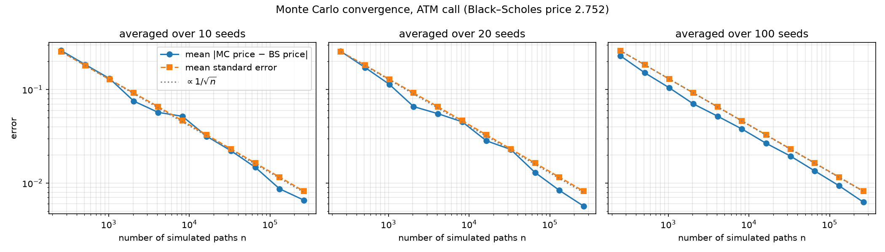
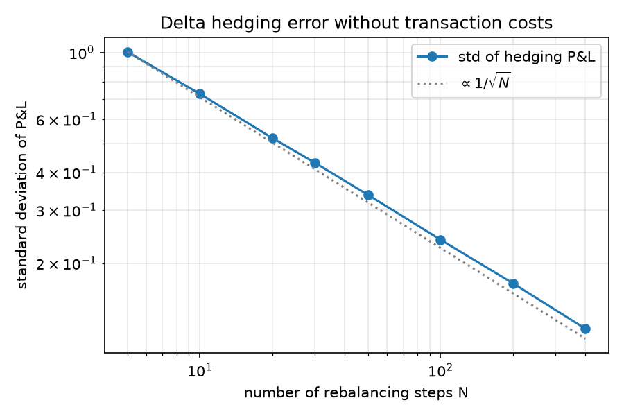
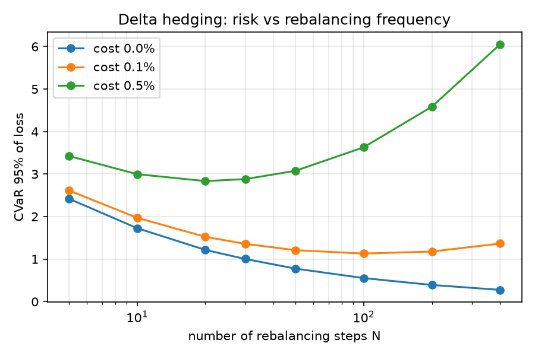
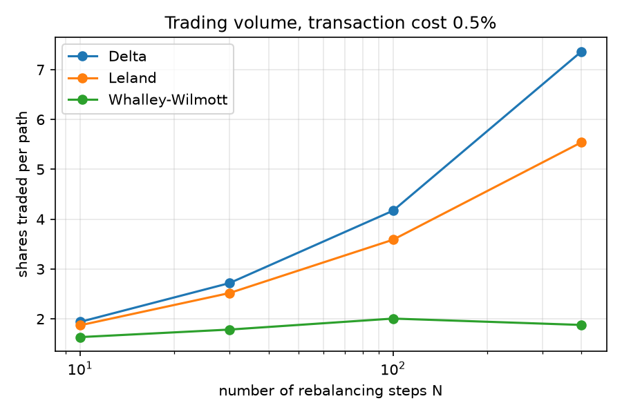
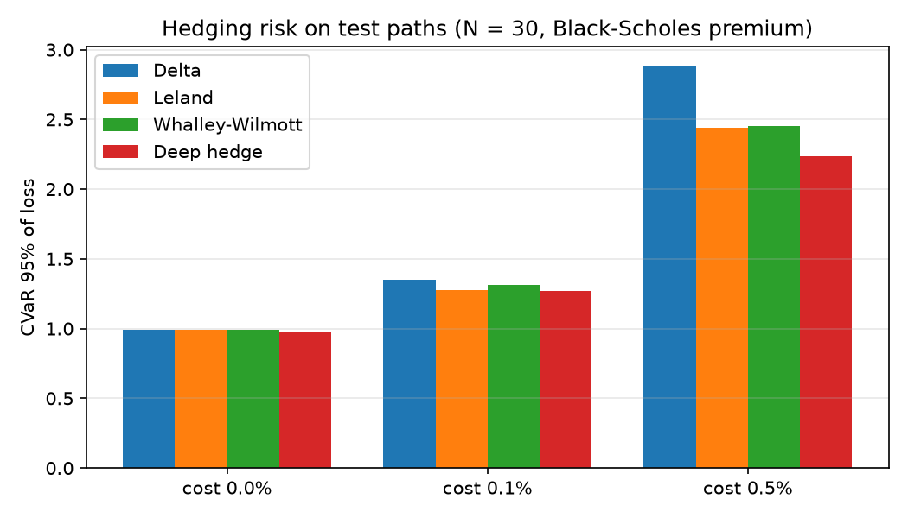
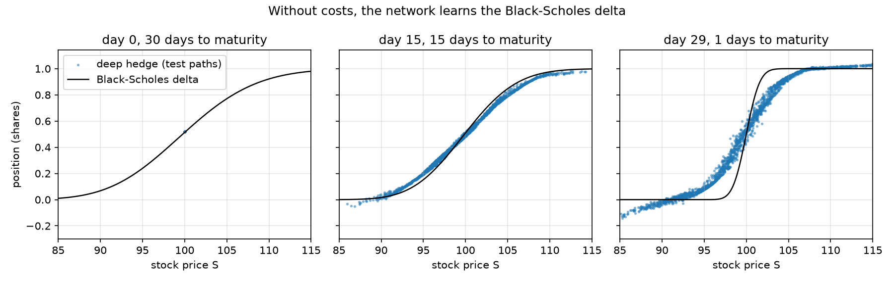
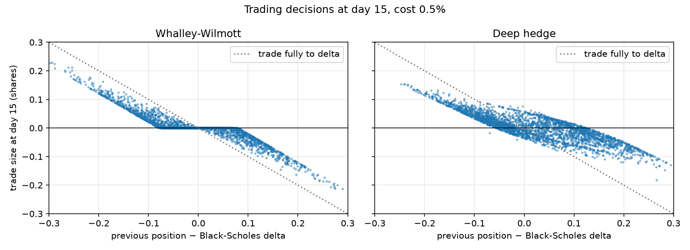

# deep-hedging

Deep hedging of European options under transaction costs and stochastic volatility (Heston), compared against classical benchmarks. Python / PyTorch.

## Question

A bank sells an option and hedges it by trading the underlying at discrete times. With transaction costs or stochastic volatility, the classical Black–Scholes delta hedge is no longer optimal, and in general there is no closed-form answer.

Following Buehler, Gonon, Teichmann and Wood (2019), this project trains a neural network to choose the hedge position directly, by minimising a risk measure (CVaR) of the hedger's terminal profit and loss on simulated price paths. It then asks:

- Does the network recover the Black–Scholes delta when there are no costs?
- With transaction costs, does it learn to trade less, and how does it compare with the Leland and Whalley–Wilmott strategies?
- Under Heston stochastic volatility, how much better is it than the misspecified Black–Scholes delta?

## Roadmap

- [x] Black–Scholes pricer and delta
- [x] Geometric Brownian motion simulator
- [x] Monte Carlo pricing with standard errors, validated against Black–Scholes
- [x] Heston simulator and semi-analytic Heston pricer
- [x] Classical hedging baselines: delta, Leland, Whalley–Wilmott
- [x] Deep hedging network with CVaR loss (PyTorch)
- [x] Experiments with transaction costs
- [ ] Experiments under Heston

## Results so far

Comparing Monte Carlo pricing to Black-Scholes exact pricing.

| Option | S₀  | K   | T      | r   | σ   | Black–Scholes | Monte Carlo | Std. error | z     |
|--------------------------------------------------------------------------------------------|
| Call   | 100 | 100 | 1      | 5%  | 20% | 10.4506       | 10.4645     | 0.0329     | +0.42 |
| Put    | 100 | 100 | 1      | 5%  | 20% | 5.5735        | 5.5769      | 0.0194     | +0.17 |
| Call   | 42  | 40  | 0.5    | 10% | 20% | 4.7594        | 4.7543      | 0.0111     | -0.46 |
| Put    | 42  | 40  | 0.5    | 10% | 20% | 0.8086        | 0.8072      | 0.0041     | -0.34 |
| Call   | 100 | 105 | 30/252 | 0%  | 20% | 0.9980        | 1.0032      | 0.0057     | +0.92 |

### Monte Carlo convergence

The Monte Carlo error falls at the theoretical rate 1/√n: four times more
paths halve the error. The reported standard error correctly predicts the size
of the actual error (averaged over 20 seeds per path count).



### Delta hedging with transaction costs

Hedging a short one-month at-the-money call with the Black–Scholes delta.
Without costs, the hedging error falls like 1/√N in the number of rebalancing steps.
With proportional transaction costs, more frequent rebalancing eventually *increases*
risk: the CVaR is lowest at an intermediate frequency (around N = 100 for 0.1% costs,
N = 20 for 0.5%). Plain delta hedging has no way to trade off hedging error against
costs, which motivates cost-aware strategies and deep hedging.




### Cost-aware hedging: Leland and Whalley–Wilmott

With transaction costs, delta hedging trades too much: its risk explodes as the rebalancing
frequency grows. Leland's adjusted volatility reduces this, and Whalley–Wilmott's no-trade band
almost removes it: its trading volume and risk stay nearly constant however often trading is
allowed. All strategies receive the Black–Scholes premium, Whalley–Wilmott's risk aversion is
tuned on separate training paths.




### Deep hedging

A small neural network (3 → 32 → 32 → 1, previous position as input) trained by
minimising the CVaR of the hedging losses, following Buehler et al. (2019).
Without costs it recovers the Black–Scholes delta, except very close to maturity,
where it learns a smoother hedge. With transaction costs it achieves the lowest
CVaR of all strategies (2.23 vs 2.45 for the best classical strategy at 0.5% costs).
Instead of a sharp no-trade band like Whalley–Wilmott, it learns to adjust its
position only partially towards the delta.





## Repository structure

```
src/deep_hedging/
├── black_scholes.py     closed-form prices and delta
├── monte_carlo.py       payoffs and Monte Carlo pricing
└── models/
    └── gbm.py           geometric Brownian motion simulator
tests/                   unit tests against known theory
experiments/             one script per experiment, writes to figures/
figures/                 generated plots
```

## Setup

Requires Python 3.10 or newer.

```bash
python3 -m venv .venv
source .venv/bin/activate
pip install -e ".[dev]"
pytest
```

## References

- J. C. Hull. *Options, Futures, and Other Derivatives.* 7th ed. Pearson Prentice Hall, 2009.
- H. Buehler, L. Gonon, J. Teichmann, B. Wood. *Deep Hedging.* Quantitative Finance 19(8), 2019.
- F. Black, M. Scholes. *The Pricing of Options and Corporate Liabilities.* Journal of Political Economy, 1973.
- S. Heston. *A Closed-Form Solution for Options with Stochastic Volatility.* Review of Financial Studies, 1993.
- H. Leland. *Option Pricing and Replication with Transactions Costs.* Journal of Finance, 1985.
- A. E. Whalley, P. Wilmott. *An Asymptotic Analysis of an Optimal Hedging Model for Option Pricing with Transaction Costs.* Mathematical Finance, 1997.
- Lord, Koekkoek and van Dijk (2010), A comparison of biased simulation schemes for stochastic volatility models, Quantitative Finance.
- Albrecher, Mayer, Schoutens and Tistaert (2007), The little Heston trap, Wilmott Magazine.

## License

MIT
