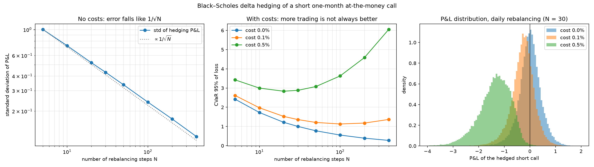
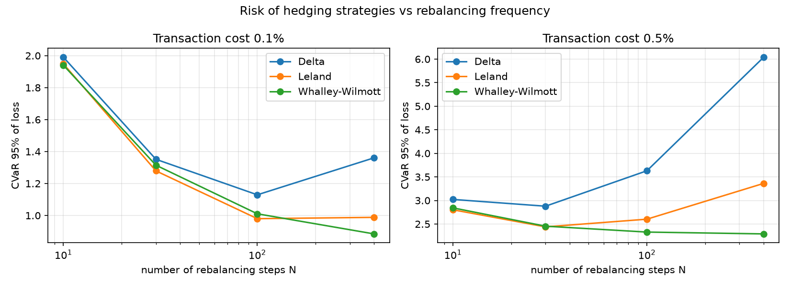
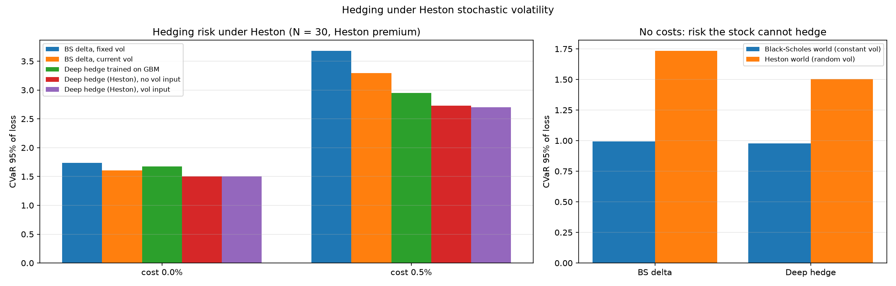
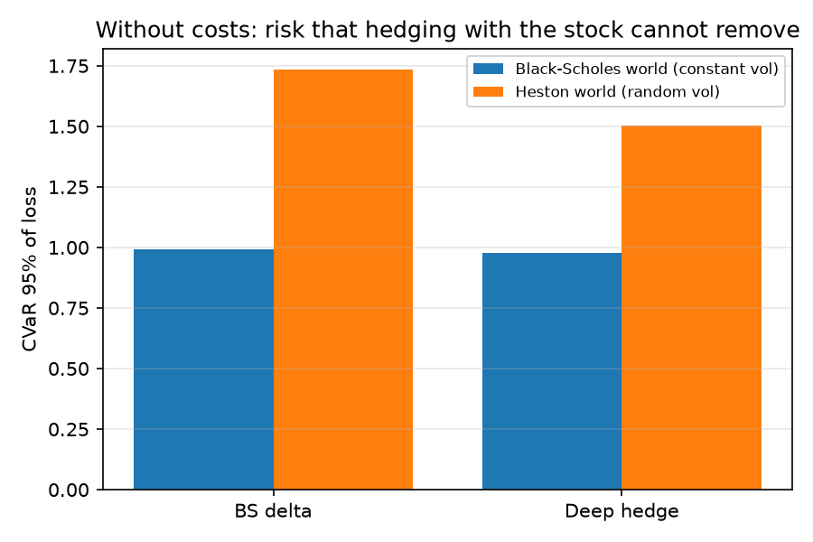

# deep-hedging

[](https://github.com/amadined/deep-hedging/actions/workflows/tests.yml)

Deep hedging of European options under transaction costs and stochastic volatility (Heston), compared against classical benchmarks. Python / PyTorch.

## Question

A bank sells an option and hedges it by trading the underlying at discrete times. With transaction costs or stochastic volatility, the classical Black–Scholes delta hedge is no longer optimal, and in general there is no closed-form answer.

Following Buehler, Gonon, Teichmann and Wood (2019), this project trains a neural network to choose the hedge position directly, by minimising a risk measure (CVaR) of the hedger's terminal profit and loss on simulated price paths. It then asks:

- Does the network recover the Black–Scholes delta when there are no costs?
- With transaction costs, does it learn to trade less, and how does it compare with the Leland and Whalley–Wilmott strategies?
- Under Heston stochastic volatility, how much better is it than the misspecified Black–Scholes delta?

## Results

### Comparison Black-Scholes price vs. Monte Carlo price

The Black-Scholes formula gives us an exact price for the option. We calculate the Monte Carlo price by
taking the mean over the discounted payoffs of 200'000 Monte Carlo simulated paths with risk-neutral drift (μ = r). 

| Option | S₀  | K   | T      | r   | σ   | Black–Scholes | Monte Carlo | Std. error | z     |
|---|---|---|---|---|---|---|---|---|---|
| Call   | 100 | 100 | 1      | 5%  | 20% | 10.4506       | 10.4645     | 0.0329     | +0.42 |
| Put    | 100 | 100 | 1      | 5%  | 20% | 5.5735        | 5.5769      | 0.0194     | +0.17 |
| Call   | 42  | 40  | 0.5    | 10% | 20% | 4.7594        | 4.7543      | 0.0111     | -0.46 |
| Put    | 42  | 40  | 0.5    | 10% | 20% | 0.8086        | 0.8072      | 0.0041     | -0.34 |
| Call   | 100 | 105 | 30/252 | 0%  | 20% | 0.9980        | 1.0032      | 0.0057     | +0.92 |

The column *z* denotes the difference between the two prices in units of std. errors (z = (MC price − BS price) / standard error).
If the simulation is correct, z follows approximately a standard normal distribution. In all five examples we have |z| < 1, 
and we conclude that the Black-Scholes price and the Monte Carlo price agree up to simulation noise. 

### Monte Carlo convergence

We price a one-month at-the-money call option by Monte Carlo with an increasing number of paths n
(doubling each time). For each n we compute the error |MC price − BS price| and the standard error.
Then we take for both the average over different independent repetitions (seeds). The figure shows
the averages over 10, 20 and 100 seeds.


Both curves fall at the theoretical rate 1/√n. The mean standard error stays almost the same in all
three plots, because it is computed from the sample standard deviation of the payoffs, which barely
depends on the seed. The actual error of a single run is random, so we see more fluctuations in the
mean error, which smooth out as the number of seeds grows. At 100 seeds the mean error is approximately
0.8 times the mean standard error, the theoretical value √(2/π) ≈ 0.80 for normally distributed errors.

### Delta hedging with transaction costs

Hedging a short one-month at-the-money call with the Black–Scholes delta.
Without costs, the hedging error falls like 1/√N in the number of rebalancing steps.
With transaction costs, the risk (CVaR) first falls and then rises again with the number of
rebalancing steps: more trading reduces the hedging error but costs more. We see there is 
an optimal rebalancing frequency (N=100 for cost 0.1%, N=20 for cost 0.5%).
The P&L distribution gets wider (larger standard devation), skewness gets more negative and the 
mean shifts to the left (more negative) with higher transaction costs. 



### Cost-aware hedging: Leland and Whalley–Wilmott

With transaction costs, delta hedging trades too much: its risk explodes as the rebalancing
frequency grows. Leland's adjusted volatility reduces this, and Whalley–Wilmott's no-trade band
almost removes it: its trading volume and risk stay nearly constant however often trading is
allowed. All strategies receive the Black–Scholes premium, Whalley–Wilmott's risk aversion is
tuned on separate training paths.




### Deep hedging

A small neural network (3 → 32 → 32 → 1, previous position as input) trained by
minimising the CVaR of the hedging losses, following Buehler et al. (2019).
Without costs it recovers the Black–Scholes delta, except very close to maturity,
where it learns a smoother hedge. With transaction costs it achieves the lowest
CVaR of all strategies (2.23 vs 2.45 for the best classical strategy at 0.5% costs).
Instead of a sharp no-trade band like Whalley–Wilmott, it learns to adjust its
position only partially towards the delta.


### Hedging under Heston stochastic volatility

With random volatility the Black–Scholes delta is misspecified and the stock alone cannot
hedge all risk. Deep hedgers trained on Heston paths have the lowest CVaR (1.50 without
costs, 2.70 with 0.5% costs), clearly better than Black–Scholes deltas with fixed (1.73 / 3.68)
or current volatility (1.61 / 3.29). Networks trained on GBM transfer reasonably but lose to
those trained in the right model. Even the best strategy keeps more risk than in the
Black–Scholes world (1.50 vs 0.98): the cost of an incomplete market.




## Extensions

- [] Repeat the training with several seeds.
- [] Better inputs near maturity.
- [] Other risk measures.

## Future work

- A second hedging instrument under Heston.
- Other types of options.
- Work with real market data.
- Other volatility models. (rough Bergomi)


## Repository structure

```
src/deep_hedging/
├── black_scholes.py     closed-form Black–Scholes prices, delta and gamma
├── heston_pricing.py    semi-analytic Heston prices (characteristic function)
├── monte_carlo.py       payoffs and Monte Carlo pricing with standard errors
├── hedging.py           P&L of a hedged short option and trading volume (NumPy)
├── risk.py              VaR, CVaR and summary statistics of the P&L
├── baselines.py         classical strategies: delta, Leland, Whalley–Wilmott
├── deep_hedger.py       neural hedging strategy and its training (PyTorch)
└── models/
    ├── gbm.py           geometric Brownian motion simulator (exact)
    └── heston.py        Heston simulator (full-truncation Euler)
tests/                   unit tests against known theory and hand-checked examples
experiments/             one script per experiment, writes to figures/
figures/                 generated plots
models/                  trained networks (created by experiments 04 and 05, not in git)
```

## Setup

Requires Python 3.10 or newer.

```bash
python3 -m venv .venv
source .venv/bin/activate
pip install -e ".[dev]"
pytest
```

## Running the experiments

Run each script from the repository root. Figures are written to `figures/`.

```bash
python experiments/00_mc_validation.py      # Monte Carlo vs Black–Scholes prices (table)
python experiments/01_mc_convergence.py     # Monte Carlo convergence rate
python experiments/02_delta_hedging.py      # delta hedging with transaction costs
python experiments/03_cost_aware_hedging.py # Leland and Whalley–Wilmott
python experiments/04_deep_hedging.py       # deep hedging vs classical strategies
python experiments/05_heston_hedging.py     # hedging under Heston stochastic volatility
```

Experiments 00–03 take seconds to about a minute. Experiments 04 and 05 train neural
networks, which takes a few minutes per network on a laptop CPU. The trained networks are
saved in `models/` and reused on later runs. Delete that folder to retrain from scratch.

## References

- J. C. Hull. *Options, Futures, and Other Derivatives.* 7th ed. Pearson Prentice Hall, 2009.
- H. Buehler, L. Gonon, J. Teichmann, B. Wood. *Deep Hedging.* Quantitative Finance 19(8), 2019.
- F. Black, M. Scholes. *The Pricing of Options and Corporate Liabilities.* Journal of Political Economy, 1973.
- S. Heston. *A Closed-Form Solution for Options with Stochastic Volatility.* Review of Financial Studies, 1993.
- H. Leland. *Option Pricing and Replication with Transactions Costs.* Journal of Finance, 1985.
- A. E. Whalley, P. Wilmott. *An Asymptotic Analysis of an Optimal Hedging Model for Option Pricing with Transaction Costs.* Mathematical Finance, 1997.
- R. Lord, R. Koekkoek, D. van Dijk. *A Comparison of Biased Simulation Schemes for Stochastic Volatility Models.* Quantitative Finance 10(2), 2010.
- H. Albrecher, P. Mayer, W. Schoutens, J. Tistaert. *The Little Heston Trap.* Wilmott Magazine, 2007.

## License

MIT
